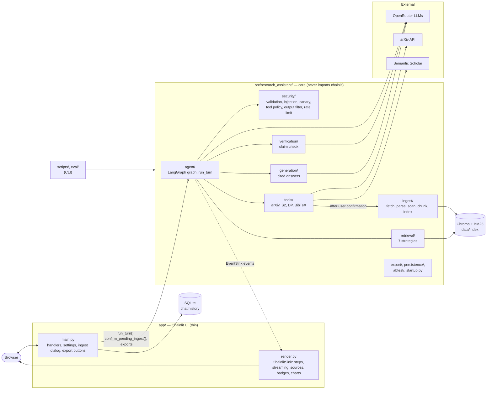
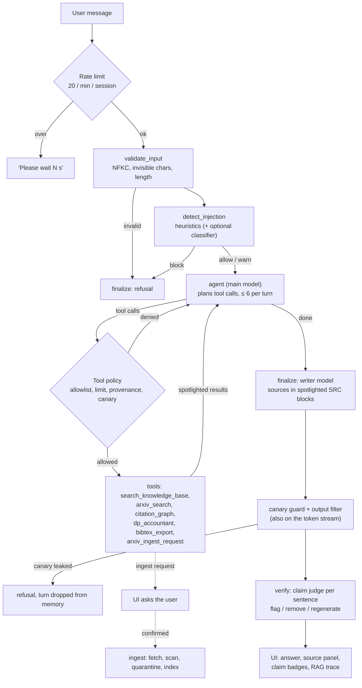

# ML Privacy & Security Research Assistant

A cited research assistant for machine-learning privacy and security: membership inference,
differential privacy and DP-SGD, model inversion, training-data extraction and prompt
injection. Ask a question and a LangGraph agent searches a local index of 194 arXiv papers.
It can also call domain tools (DP accountant, citation graph, arXiv search, BibTeX). The
answer cites a specific chunk of a specific paper for every claim. A second model then
checks each cited sentence against the text it cites, and the UI marks it as supported,
partially supported or unsupported. Retrieved paper text is handled as untrusted input:
hidden LaTeX instructions are quarantined at ingest, sources reach the model only inside
spotlighted delimiters, tool calls go through a policy, and the output is checked for canary
leaks and exfiltration links before anyone sees it.

<!-- Demo GIF: record it, save it as docs/demo.gif and uncomment the next line.

-->

## Highlights

- **Cited RAG over 194 papers.** Hybrid dense + BM25 retrieval with 7 configurable strategies;
  every claim cites a numbered chunk, shown in a side panel
  ([RAG pipeline](#rag-pipeline), [Knowledge base](#knowledge-base)).
- **Agent with 6 tools.** LangGraph tool calling (knowledge-base search, DP accountant,
  citation graph, arXiv search, BibTeX, ingest request); adding a paper needs the user's
  confirmation ([Tool calling](#tool-calling)).
- **Claim verification.** A second model checks every cited sentence against its source and
  quotes the evidence; the UI shows a badge per sentence.
- **Prompt-injection defenses, tested end to end.** Hidden-text quarantine at ingest,
  spotlighting, tool policy, canary tokens and an exfiltration filter; five poisoned papers
  run through the real pipeline against a fully compromised mocked LLM
  ([Security](#security)).
- **Measured, not guessed.** Offline A/B evaluation with gold questions, an LLM judge and
  paired bootstrap confidence intervals ([Results](#results)).
- **Built to be maintained.** Core logic separated from the Chainlit UI (enforced by a
  test), typed Pydantic boundaries, resilient API wrappers, startup checks, 605 offline
  tests ([Architecture](#architecture), [Error handling](#error-handling)).

## Contents

- [Architecture](#architecture)
- [RAG pipeline](#rag-pipeline)
- [Tool calling](#tool-calling)
- [Quickstart](#quickstart)
- [Knowledge base](#knowledge-base)
- [Features](#features)
- [Error handling](#error-handling)
- [Security](#security)
- [Results](#results)
- [Limitations](#limitations)
- [Roadmap](#roadmap)
- [Project layout and commands](#project-layout-and-commands)

## Architecture

All logic lives in `src/research_assistant/` (the *core*), which never imports Chainlit.
`app/` is a thin Chainlit layer: it calls core functions and renders the events they emit
through the `EventSink` protocol. `tests/test_architecture.py` enforces the split. The same
core serves the web UI, the CLI scripts and the offline evaluation.

Organisation principles:

- **One package per concern** (`ingest/`, `retrieval/`, `generation/`, `agent/`, `tools/`,
  `verification/`, `security/`, `export/`, `abtest/`), each with a small public API, e.g.
  `retrieve(question, strategy, sink, deps)`, `generate_answer(...)`, `run_turn(...)`.
- **Typed boundaries:** Pydantic v2 models for everything that crosses modules (`Chunk`,
  `ScoredChunk`, `RetrievalResult`, `Citation`, `Answer`, `ToolResult`, `TurnResult`, ...).
- **Dependency injection:** heavy or external parts (index, LLMs, HTTP clients, judge) are
  passed in through `*Deps` objects, so every unit test runs offline with fakes.
- **Configuration, not code:** models, limits, paths and strategies live in
  `config/settings.yaml` and `config/strategies.yaml`, validated at startup; secrets only
  in `.env`.
- **One wrapper per external service** (`llm.py`, `ingest/arxiv_fetch.py`,
  `tools/semantic_scholar.py`) with timeout, retries (tenacity, exponential backoff) and
  typed errors.



### Request pipeline

Each message goes through one LangGraph turn. Every model call and external call is wrapped
with a timeout, tenacity retries with exponential backoff and a typed error, and the main
model falls back to `models.fallback` on provider errors.



## RAG pipeline

The model answers from passages retrieved for the question, not from its own memory, and every
claim points to the passage it came from.

1. **Ingest** (`ingest/`, offline, `uv run just ingest`). Each paper's LaTeX source is parsed
   (macros expanded, `\input` files followed, sections kept), with a PDF fallback. Before
   conversion, the source is scanned for hidden text (see [Security](#security)).
2. **Chunk.** Each section is split into chunks of at most 800 tokens with 100 tokens
   overlap, so a chunk never mixes sections. Each chunk carries metadata: arXiv ID, title,
   authors, year, section, topic and security flags.
3. **Index.** Every chunk is embedded locally with `BAAI/bge-small-en-v1.5` (normalized, cosine
   similarity) and stored in Chroma. The same chunks also go into a BM25 keyword index, since
   exact terms such as "LiRA", "RDP" or "ε" matter in this domain.
4. **Retrieve** (`retrieval/`). A strategy from `config/strategies.yaml` decides how. Options:
   - dense search, BM25, or both fused with reciprocal rank fusion
     (`score = Σ 1 / (60 + rank)`);
   - query translation by an LLM: multi-query rewrites, HyDE (embed a hypothetical answer),
     or decomposition into sub-questions;
   - self-query: the LLM extracts filters (year range, topic, authors) that go to Chroma as
     metadata filters;
   - a cross-encoder reranker (`BAAI/bge-reranker-base`).

   Every strategy caps chunks per paper (2) for diversity and never returns quarantined
   chunks. The app default `baseline_dense_tuned` (dense, 12 chunks) was chosen on the dev
   split and confirmed on the test split (see [Results](#results)).
5. **Augment.** The retrieved chunks are numbered and put into the writer's prompt, each
   inside a delimiter with a random per-request boundary:
   `<<SRC-3f9a1c0e id=3 paper="..." ref="Carlini et al. 2021" section="...">> … <<END-3f9a1c0e>>`.
   The system prompt says that everything inside is data, never instructions, and that every
   factual sentence must cite a source number.
6. **Generate.** The answer streams to the UI. Afterwards the `[n]` markers are validated:
   a marker that points to no source is removed and logged as a citation error. Valid markers
   are rendered as `(Carlini et al. 2021 [1])`, and the side panel shows the exact chunk.
   When nothing relevant is retrieved, the app says so instead of answering from model
   memory.
7. **Verify** (`verification/`). The answer is split into sentences. A judge model checks each
   cited sentence against the chunks it cites and must quote an evidence span; the quote is
   verified in the chunk text, and a made-up quote counts as unsupported. The UI shows a
   badge per sentence: ✓ supported, ◐ partial, ✗ unsupported, ? no citation. Policy `remove`
   drops unsupported sentences; `regenerate` revises the answer once.

The "How this answer was built" view under each answer shows this pipeline for the actual
question: the rewritten queries, filters, the candidates of each retriever with their ranks
and scores, the reranker scores, the chunks that were kept, and the latency per stage.

## Tool calling

The agent is a LangGraph `StateGraph` (`agent/graph.py`). The main model does not answer
directly. It decides which tools to call, and a separate writer composes the answer from
what the tools returned.

1. **Tool definitions.** Each tool has a Pydantic argument schema (`extra="forbid"`, typed
   fields with limits and descriptions) and a plain Python function that returns a
   `ToolResult(ok, data | error, source)` and never raises (`tools/base.py: run_safely`).
   `tools/registry.py` wraps them as LangChain `StructuredTool`s; the JSON schemas are
   generated from the Pydantic models.

   | Tool | Does | External call |
   |---|---|---|
   | `search_knowledge_base` | RAG retrieval (above) | local index |
   | `dp_accountant` | ε for DP-SGD from noise multiplier, sampling rate, steps, δ (RDP and PLD) | none (`dp-accounting`) |
   | `citation_graph` | papers citing / cited by an arXiv paper | Semantic Scholar |
   | `arxiv_search` | find papers not in the knowledge base | arXiv API |
   | `bibtex_export` | BibTeX entries for arXiv IDs | arXiv API |
   | `arxiv_ingest_request` | *propose* adding a paper; creates a pending request only | none |

2. **Binding.** `llm.get_tool_calling_llm` calls `ChatOpenAI(...).bind_tools(schemas)`, using
   OpenRouter's OpenAI-compatible function calling. The fallback model is bound to the same
   tools.
3. **Loop.** The `agent` node sends the system prompt, conversation history and current
   messages. If the reply contains `tool_calls`, the `tools` node handles each call:
   1. `ToolPolicy.authorize`: allowlist, ≤ 6 calls per turn, ingest provenance, no canary in
      the arguments;
   2. validate the arguments with the Pydantic schema (errors go back to the model as a tool
      error, not an exception);
   3. run the tool and write the call to the audit log;
   4. return the result as a `ToolMessage` containing JSON inside `<<TOOL-boundary>>`
      delimiters.

   Control returns to `agent` until the model stops calling tools, or 6 tool calls or
   6 agent steps are used up.
4. **Answer.** `finalize` gives the writer the retrieved chunks as sources `[1]…[n]` and the
   tool results as `[T1]…[Tn]`, so a DP computation is cited like a paper: "ε ≈ … (dp_accountant
   [T1])".
5. **Side effects need the user.** Adding a paper downloads, parses and indexes it, so the
   model cannot do it alone. `arxiv_ingest_request` only returns a pending request. The UI
   shows an *Ingest / Cancel* dialog, and only a click calls
   `confirm_pending_ingest`, which runs the ingest pipeline with a progress task list.
   The arXiv ID must come from the user or from an arXiv / Semantic Scholar result, never
   only from paper text.

Example: *"What ε does DP-SGD reach with σ = 1.1, q = 0.01, 10,000 steps, δ = 1e-5?"* → the
model calls `dp_accountant(noise_multiplier=1.1, sample_rate=0.01, steps=10000,
delta=1e-5)` → the result comes back as a spotlighted `ToolMessage` → the model stops → the
writer answers and cites `[T1]`. The step view in the UI shows each call, its arguments,
result and latency.

## Quickstart

**Requirements:** [uv](https://docs.astral.sh/uv/) (it installs Python 3.12 itself), git,
an [OpenRouter](https://openrouter.ai/) API key with credit, and about 4 GB of disk
(about 1.5 GB virtualenv, 1.7 GB raw papers, 0.2 GB index). The task runner
[`just`](https://just.systems/) is a dev dependency, so `uv run just …` works without
installing anything else. The dependency pins support Intel Macs (PyTorch 2.2.2, NumPy 1.x).

```bash
# 1. Clone and install (creates .venv and, if missing, .env from .env.example)
git clone https://github.com/chris-t-ian/MLsec-Research-Assistant.git
cd MLsec-Research-Assistant
uv run just setup

# 2. Fill in .env:
#    OPENROUTER_API_KEY=...            (required)
#    CHAINLIT_AUTH_SECRET=...          (generate with: uv run chainlit create-secret)
#    DEMO_USERNAME=demo / DEMO_PASSWORD=...   (the web login)
#    SEMANTIC_SCHOLAR_API_KEY=...      (optional, higher rate limit)

# 3. Download the corpus from arXiv (194 papers; arXiv allows one request every 3 s,
#    so this takes 20+ minutes). For a quick try, download only the first 5 papers:
uv run just corpus        # or: uv run just corpus 5

# 4. Build the search index (LaTeX parse, injection scan, chunking, embeddings).
#    The full corpus takes about an hour on a laptop CPU; 5 papers take a few minutes.
#    The embedding model (BAAI/bge-small-en-v1.5) is downloaded on first use.
uv run just ingest

# 5. Create the chat-history database and start the app
uv run just db
uv run just app           # runs the startup checks, then http://localhost:8000
```

Log in with `DEMO_USERNAME` / `DEMO_PASSWORD`. Try a starter question, or type `/help`.

`uv run just app` runs `uv run just check` first. If something is missing (a key, the index,
a bad value in `config/settings.yaml`) it stops with a readable list instead of a stack
trace, for example:

```text
The research assistant cannot start:
  - [index] No search index found in data/index. Build it with `uv run just corpus` ...
```

Run the tests (all network calls are mocked; no API key needed):

```bash
uv run just test          # ruff check, ruff format --check, pytest
```

## Knowledge base

The domain is ML privacy and security research, a field where answers need precise
sources: attack success rates, ε values and threat models differ between papers.

| Topic | Papers |
|---|---:|
| Membership inference | 64 |
| Differential privacy / DP-SGD | 37 |
| Prompt injection | 33 |
| Training-data extraction | 30 |
| Model inversion | 28 |
| Other | 2 |
| **Total** | **194** |

- **Source:** arXiv papers listed in `data/papers.yaml` (IDs only; the papers are downloaded,
  not redistributed). LaTeX source is preferred over PDF for clean text and math.
- **Size:** 7,970 chunks; about 1.7 GB raw sources and 0.2 GB index.
- **Coverage:** foundational and recent work, e.g. Shokri et al.'s membership inference
  attack, LiRA, DP-SGD and its accountants, training-data extraction from language models,
  and indirect prompt injection.
- **Growable at runtime:** the arXiv tool can add papers after user confirmation; they are
  scanned and indexed the same way.
- **Gold questions:** `eval/gold_questions.yaml` has 62 questions (factual, comparison,
  method, 5 out of scope) with gold papers and key facts, split 20 dev / 42 test.

## Features

What the app does, by area, and where the code lives.

| Area | What the project does | Where |
|---|---|---|
| Data collection and processing | 194 arXiv papers in 5 topics (`data/papers.yaml`), downloaded with a rate-limited client (1 request / 3 s). LaTeX source is parsed first (macros, `\input`, sections), with a PDF fallback. Section-aware chunks of ≤ 800 tokens with 100 overlap; 7,970 chunks in total. | `ingest/`, `scripts/build_corpus.py`, `scripts/ingest.py` |
| Vector store and retrieval | Chroma (dense, local `bge-small-en-v1.5`) + BM25, fused by RRF. 7 configurable strategies: dense, hybrid, multi-query, HyDE, decomposition, self-query metadata filters, cross-encoder reranking, a per-paper chunk cap. | `retrieval/`, `config/strategies.yaml` |
| Grounded generation with citations | The writer cites numbered chunks; markers are validated and rendered as author-year references with a side panel showing the exact chunk. Tool results are citable as `[T1]`. | `generation/` |
| Agent and tools | LangGraph agent with 6 tools: knowledge-base search, arXiv search, arXiv ingest request (executed only after the user confirms in the UI), Semantic Scholar citation graph, DP-SGD privacy accountant (RDP and PLD), BibTeX export. Conversation memory per session. | `agent/`, `tools/` |
| Answer quality control | Claim verification: a judge model checks every cited sentence against its chunks and must quote an evidence span (verified in the text). Policies: flag (badges), remove, regenerate once. | `verification/` |
| Security | Input validation, injection detection, ingest-time hidden-text scan and quarantine, spotlighting, canary tokens, tool policy with provenance and audit log, output link/image filter, rate limit. See [Security](#security). | `security/`, `ingest/injection_scan.py` |
| User interface (Chainlit) | Chat with token streaming and per-step progress (`cl.Step`), source side panel (`cl.Text` elements linked from the citations), claim badges, a "How this answer was built" RAG trace with Plotly charts, chat settings (strategy, top_k, model), starters, two chat profiles (Research Assistant and an App Guide that answers questions about the app from `app/help.md`), `/help` command, ingest confirmation dialog (`cl.AskActionMessage`) with a task list, password login, chat history sidebar, export buttons, custom theme, CSS and JS. | `app/`, `public/`, `.chainlit/config.toml` |
| Persistence and export | Login, SQLite chat history with resumable threads, export of a conversation as JSON, CSV (messages and citations) or PDF. | `persistence/`, `export/` |
| Evaluation | 62 gold questions (20 dev / 42 test, incl. out-of-scope), LLM judge for key facts and refusals, paired bootstrap CIs, retrieval-only grid tuning on dev with a single test confirmation, supported-claim rate per verification mode with an independent judge, hand-label agreement (accuracy, Cohen's kappa, flag precision/recall). | `abtest/`, `eval/` |
| Engineering | Core/UI split enforced by a test; Pydantic v2 models at module boundaries; every external call with timeout, retries and a typed error; config validated at startup; mocked unit tests incl. an end-to-end injection test; ruff. | `tests/`, `startup.py` |

## Error handling

| Scenario | What happens | Tested in |
|---|---|---|
| OpenRouter returns 429 / 5xx / times out | Client retries with exponential backoff (tenacity), then the fallback model (`models.fallback`) answers | `test_hardening.py` |
| No credits (402) or invalid API key | Not retried. The user sees "The language model could not produce an answer right now"; details are only in the server log | `test_generation.py` |
| Stream breaks after tokens were shown | Not retried, so no text is duplicated; friendly error | `test_generation.py` |
| Agent model fails mid-turn | The writer answers from the evidence collected so far | `test_agent.py` |
| arXiv or Semantic Scholar down or rate-limited | Retries, then a friendly tool error ("arXiv is not reachable right now..."); the turn still finishes | `test_hardening.py`, `test_tools_*.py` |
| Nothing relevant retrieved | The app says it found no matching passages and suggests the arXiv search, instead of answering from model memory | `test_generation.py` |
| Model cites a source that does not exist (`[9]` of 8) | Marker removed, citation error recorded | `test_generation.py` |
| Model cites but the chunk does not support the claim | Claim check marks ✗ (or removes / regenerates, depending on the policy) | `test_verification.py` |
| Claim judge unavailable | The answer is kept and marked "Claim check unavailable" | `test_agent.py` |
| Question outside the domain | The writer declines or corrects; measured as "correct refusal" in the eval | `eval/` |
| Empty, too long (> 2,000 chars) or obfuscated input (invisible / control characters, 200+ character tokens) | Normalized or rejected with a readable reason | `test_security.py` |
| Model invents tool arguments | Pydantic validation; the error goes back to the model as a tool error | `test_tools_arxiv.py` |
| Model loops on tools | Hard cap of 6 tool calls and 6 agent steps per turn | `test_agent.py` |
| Ingest of an invalid ID, a paper already indexed, or the user cancels or does not answer (300 s) | Nothing is downloaded or written | `test_tools_arxiv.py`, `test_agent.py` |
| Missing index, missing keys, invalid `settings.yaml`, unknown default strategy | Startup stops with a readable list of problems and the fix (e.g. `uv run just ingest`) | `test_hardening.py` |
| Index built with another embedding model | Clear error telling to rebuild with `--rebuild` | `test_index.py` |
| A model that is not in the configured list is requested | Friendly message; invalid chat settings are ignored and the previous value is kept | `test_agent.py` |
| More than 20 messages per minute | "Please wait N seconds" | `test_hardening.py` |
| arXiv tarball with path traversal or a zip bomb | Rejected at extraction (size and path checks) | `test_arxiv_fetch.py` |
| Any unexpected exception | Generic message with an error id; the stack trace is only in the server log | `app/main.py` |

## Security

Retrieved paper text, tool outputs (titles, abstracts) and user input are all treated as
untrusted. The defenses are layered, so a model that follows an injected instruction still
cannot act on it. `tests/test_injection_e2e.py` checks this with a fully compromised mocked
LLM and five poisoned papers that go through the real ingest, index and agent pipeline.

| Threat | Defense | Test |
|---|---|---|
| Hidden instructions in papers (white text, `\phantom`, tiny fonts, ...) | Ingest scan; chunks with hidden AI-directed text are **quarantined**: stored for audit, excluded from both retrievers. | `test_injection_e2e.py`, `test_injection_scan.py` |
| Instructions in visible paper text | **Spotlighting**: sources and tool results reach the model only inside delimiters with a random per-request boundary, and the system prompt declares their content data. Delimiter look-alikes are stripped from the text. Optional datamarking. | `test_injection_e2e.py`, `test_generation.py` |
| Tool hijacking | **Tool policy** on every call: allowlist; ≤ 6 calls per turn; ingestion is never a model tool (the model can only *propose* it, the user confirms in the UI); an arXiv ID may be proposed only if it came from the user or an arXiv / Semantic Scholar result, never only from paper text. Every decision is written to an audit log. | `test_injection_e2e.py`, `test_security.py` |
| System-prompt / secret exfiltration | **Canary token** per session in every system prompt. If it shows up in model output (also spaced out or reformatted) or in tool arguments, the answer is replaced by a refusal, the turn is removed from memory and an incident is logged. Streamed tokens are held back so the canary never reaches the browser. | `test_injection_e2e.py`, `test_agent.py` |
| Data exfiltration through rendered markdown | **Output filter**: images and links are allowed only for `arxiv.org`, `semanticscholar.org`, `doi.org` (and subdomains). Everything else is removed from the answer *and* the token stream (`` would otherwise load without a click). The host is parsed with `urlsplit`, so `https://arxiv.org@evil.example/` does not pass; HTML is not rendered (`unsafe_allow_html = false`). | `test_output_filter.py`, `test_injection_e2e.py` |
| Malicious user input | NFKC normalization, invisible and control characters stripped, length limits, heuristic injection scoring (optional DeBERTa classifier, which alone can only warn). | `test_security.py` |
| Abuse / cost | Per-session rate limit (20 messages / minute), LLM output token cap. | `test_hardening.py` |
| Leaking internals | Friendly error messages with an error id; no stack traces, keys or prompts in the UI. Secrets only from `.env` (never committed); config errors list field names, never values. | `test_hardening.py` |

Residual risks: an allowlisted host is fully trusted (`doi.org` redirects to publisher
sites). The rate limiter is in memory and per process. The injection heuristics are
English-centric. A real model may still *say* something an injection asked for (for example
a biased recommendation), within the limits of what it can cite.

## Results

All numbers below come from the run directories under `eval/results/` and were not edited.
Answers come from `anthropic/claude-sonnet-5.5` at temperature 0. CIs are 95% percentile
bootstrap intervals over questions (10,000 resamples, seed 0), and Δ are paired differences
to `baseline_dense`. A CI that includes 0 means *no detectable difference*, not *no
difference*: with 20 to 40 questions only large effects are visible.

### Retrieval A/B on the test split (final confirmation)

`eval/results/confirm-20261123-132343`: 39 in-scope test questions. The configurations were
fixed on the dev split beforehand (`eval/results/tuning-20261123-102932`, 84 grid variants)
and checked once on test. *Gold papers found* is the share of a question's gold papers among
the retrieved chunks (comparison questions have several).

| Strategy | Gold papers found | Recall (any gold paper) | MRR | Context tokens | Δ gold found vs. baseline |
|---|---|---|---|---|---|
| `baseline_dense` | 0.46 [0.38, 0.54] | 0.95 [0.87, 1.00] | 0.78 [0.67, 0.88] | 3,856 | — |
| `full` (multi-query + filters + hybrid + rerank) | 0.43 [0.35, 0.51] | 0.90 [0.79, 0.97] | 0.77 [0.65, 0.88] | 3,698 | −0.03 [−0.12, +0.05] |
| `full_tuned` (top_k 12, rerank_k 30) | 0.53 [0.44, 0.62] | 0.92 [0.82, 1.00] | 0.75 [0.63, 0.86] | 5,257 | +0.07 [−0.04, +0.17] |

`full_tuned` finds more gold papers, but it also returns about 1,400 more context tokens per
search (Δ +1,401 [+755, +1,997]), and the difference to `baseline_dense` is not significant.
`full` was best on dev by MRR, but that edge did not hold on test. Query translation in this
run used `anthropic/claude-haiku-4.5`; the app uses `models.judge`. The app default is
`baseline_dense_tuned` (dense, top_k 12), confirmed separately below.

**App default on test.** `eval/results/confirm-20261124-102727`: the same 39 questions, run
after the default was chosen. Both strategies now use the 2-chunks-per-paper cap, so this
`baseline_dense` (top_k 8) scores slightly higher than in the run above (cap 3). Dense search
needs no LLM call, so the run cost nothing. It is a second test-split run, logged in
`eval/results/test_runs.log`. No parameter was changed on the basis of the first.

| Strategy | Gold papers found | Recall (any gold paper) | MRR | Context tokens | Δ gold found vs. baseline |
|---|---|---|---|---|---|
| `baseline_dense` (top_k 8) | 0.49 [0.41, 0.57] | 0.95 [0.87, 1.00] | 0.78 [0.67, 0.88] | 3,848 | — |
| `baseline_dense_tuned` (top_k 12) | 0.58 [0.49, 0.66] | 0.95 [0.87, 1.00] | 0.78 [0.67, 0.88] | 5,866 | +0.09 [+0.05, +0.12] |

The tuned default finds significantly more gold papers (dev: +0.16). The gain comes only from
the 4 extra chunks: the top-ranked chunks are the same (Δ MRR 0), and each search adds about
2,000 context tokens (Δ +2,018 [+1,819, +2,201]).

### End-to-end A/B (answers): dev pilot

`eval/results/20261122-133339`: 5 dev questions (4 in scope, 1 out of scope) × 5 strategies,
judge `google/gemini-3.8-flash`. This is a smoke-test-sized pilot. Recall@8 was 1.0 and the
out-of-scope question was refused correctly for every strategy.

| Strategy | Key-fact coverage (n=4) | Δ vs. baseline | Gold-citation rate (n=4) | Δ vs. baseline | Tokens / question | Latency / question |
|---|---|---|---|---|---|---|
| `baseline_dense` | 0.85 [0.71, 1.00] | — | 0.59 [0.32, 0.86] | — | 45,026 | 24.1 s |
| `hybrid` | 0.88 [0.63, 1.00] | +0.02 [−0.19, +0.25] | 0.58 [0.31, 0.86] | −0.01 [−0.05, +0.03] | 36,492 | 18.2 s |
| `hybrid_multiquery` | 0.88 [0.75, 1.00] | +0.02 [−0.19, +0.25] | 0.47 [0.30, 0.64] | −0.12 [−0.24, −0.00] | 50,164 | 38.6 s |
| `hybrid_hyde_rerank` | 0.88 [0.63, 1.00] | +0.02 [−0.19, +0.25] | 0.59 [0.32, 0.86] | −0.00 [−0.07, +0.07] | 49,739 | 60.5 s |
| `full` | 0.79 [0.69, 0.94] | −0.06 [−0.19, 0.00] | 0.69 [0.49, 0.90] | +0.10 [+0.03, +0.18] | 48,590 | 71.9 s |

**Pending:** the end-to-end test-split run `eval/results/20261123-123204` (`baseline_dense`,
`full`, `full_tuned` × 42 questions) stopped after 16 of 126 turns. Continue it with
`uv run just eval --resume eval/results/20261123-123204` (about $0.13 per turn).

### Supported-claim rate per verification mode

The supported-claim rate is supported claims / (cited claims + uncited factual sentences).
Partially supported claims count as not supported.

**Independent judge (pending).** `uv run just eval-verification` runs `baseline_dense_tuned`
with verification `off`, `flag` and `regenerate` on the dev split. It scores the final answer
of every arm with `models.eval_judge` (`openai/gpt-4.1-mini`), a different model family from
both the writer (Anthropic) and the verifier (`google/gemini-3.8-flash`). That way the
`regenerate` arm is not graded by the judge it was revised against. That run has not been
done yet. Its `report.md` will contain the table that belongs here.

**Verifier-judged pilot.** `eval/results/20261123-073127`: `hybrid`, 2 dev questions, scored
by the verifier judge itself (not independent):

| Mode | Supported-claim rate (n=2) | Δ vs. off | Tokens / question | Latency / question |
|---|---|---|---|---|
| off | 0.43 [0.38, 0.48] | — | 33,373 | 27.2 s |
| flag | 0.54 [0.38, 0.70] | +0.11 [0.00, +0.21] | 67,399 | 58.2 s |
| regenerate | 0.52 [0.50, 0.55] | +0.09 [+0.07, +0.12] | 82,448 | 49.1 s |

`flag` does not change the answer text. Its difference to `off` is therefore run-to-run
variation of the generated answer, which shows how noisy two questions are.

### Claim flags vs. hand labels (pending)

`uv run just label eval/results/<run>` shows sampled judged claims with the full cited
chunks, hides the judge's label and asks for your own (supported / partially / unsupported).
The report (`judge_agreement.md`) gives accuracy, Cohen's kappa and **flag precision /
recall**. A claim counts as *flagged* when the judge does not label it supported (badge ◐ or
✗), and as *bad* when the hand label is not supported. No claims have been labelled yet, so
there are no numbers.

## Limitations

What can go wrong or is weaker than it looks, and why.

- **Small, curated corpus.** 194 papers (7,970 chunks) in five topics. Questions outside
  them are refused or answered thinly. Papers added at runtime through the arXiv tool are
  indexed the same way, but live ingestion is slow on CPU.
- **Optimistic absolute recall.** The corpus and the gold questions were built together:
  papers were selected *for* the questions. Absolute recall (0.9+ "any gold paper") is
  therefore higher than for an open-ended literature search. The comparisons *between*
  strategies are the meaningful part.
- **Judge errors.** Key-fact coverage, refusals and claim support are judged by LLMs. The
  claim judge must quote an evidence span that is checked against the chunk, which catches
  invented evidence but not every wrong label. Judge agreement with human labels has not
  been measured yet (see above).
- **Few questions, wide CIs.** 20 dev / 42 test questions detect only large differences.
  The end-to-end test run and the independent verification run are still pending.
- **Scan heuristics can be evaded.** The ingest scanner finds hidden LaTeX (white or
  background-colored text, `\phantom`, tiny fonts, zero scaling, hiding macros, AI-directed
  comments) and hidden PDF text. Payloads in images, unusual macro tricks, visible but
  innocuous-looking instructions, or text that only becomes harmful in combination can get
  through. Visible AI-directed text is only *flagged* (`suspicious`), not removed, because
  papers about prompt injection legitimately quote attacks.
- **Year labels** use the arXiv submission year, not the venue year (LiRA is "Carlini et al.
  2021", not S&P 2022).
- **CPU latency.** The cross-encoder reranker takes tens of seconds per query on a laptop
  CPU, so rerank strategies are not the interactive default. The first search after a
  server start also waits for the embedding model and index to load.
- **Chunks longer than the embedder's window.** Chunks are up to 800 tokens, but
  `bge-small-en-v1.5` reads at most 512, so the dense retriever does not see the tail of long
  chunks (BM25 does).
- **State is lost on restart.** Conversation memory (LangGraph `InMemorySaver`), the IDs
  trusted for ingest and the rate-limit counters live in RAM. Reopened threads show their
  messages, but not the source panels and charts (no blob storage configured).
- **Cost.** A turn with the default strategy costs about $0.13 and roughly 35–70k tokens with
  Claude Sonnet, mostly because the retrieved chunks are long. Claim verification roughly doubles
  the tokens.
- **Single demo user.** Login is one username/password from `.env`, enough for a demo but not
  for real users.

## Roadmap

**Code**

- Replace `InMemorySaver` with the SQLite checkpointer so memory and trusted IDs survive a
  restart; add blob storage so reopened threads restore source panels and charts.
- Chunk to the embedder's 512-token window (or switch to a long-context embedding model) so
  dense retrieval sees whole chunks.
- Use the `suspicious` flag in retrieval: datamark those chunks or show a warning badge.
- Faster reranking (smaller cross-encoder, ONNX, or a GPU) and an index warm-up at startup.
- Retries for Hugging Face model downloads, and a shared rate-limit store (e.g. Redis) for
  multi-process deployment; real user accounts instead of one demo login.
- Reduce cost: shorter excerpts for the planning model, fewer but better chunks per search
  (the tuned strategies trade tokens for recall), and caching answers to repeated questions.

**Project**

- Finish the pending evaluations: the test-split end-to-end run, the independent-judge
  verification run, and hand labels for judge agreement and flag precision/recall.
- Write questions independently of paper selection (or by a second person) for honest
  absolute recall, and grow the gold set beyond 62 questions to narrow the CIs.
- Red-team the scanner and the agent with more injection styles (multilingual, encoded,
  split across chunks) and track the block rate as a metric.
- Add a Dockerfile and CI (tests + ruff on every push).

## Project layout and commands

```text
app/                 Chainlit UI (main.py, render.py, help.md)
config/              settings.yaml (models, limits, paths), strategies.yaml
src/research_assistant/
  agent/             LangGraph agent, session state, turn results
  ingest/            arXiv client, LaTeX/PDF parsing, injection scan, chunking, Chroma + BM25
  retrieval/         query translation, self-query filters, reranking, strategies
  generation/        spotlighted prompts, cited answer generation
  verification/      claim splitting, judge, policies, agreement statistics
  tools/             arXiv, Semantic Scholar, DP accountant, BibTeX
  security/          input validation, injection detection, canary, tool policy,
                     output filter, rate limit
  abtest/            gold questions, metrics, judge, runner, bootstrap, reports
  export/, persistence/, rag_trace.py, app_guide.py, startup.py, config.py, llm.py
scripts/             corpus, ingest, db, setup check, CLI chat, debugging tools
eval/                gold questions, run_eval.py, tune_retrieval.py, label_claims.py, results/
tests/               unit tests (network mocked), end-to-end injection test
```

| `uv run just …` | Does |
|---|---|
| `setup` | `uv sync`, create `.env` from `.env.example` if missing |
| `corpus [N]` | download the papers in `data/papers.yaml` (first N only) |
| `ingest [--rebuild]` | parse, scan, chunk and index new papers (`--rebuild` re-indexes all) |
| `db` | create the SQLite chat-history database |
| `check` | startup checks: config, secrets, strategies, index |
| `app [PORT]` | startup checks, then the web UI |
| `test` | ruff check, ruff format check, pytest |
| `eval [ARGS]` | end-to-end A/B (default: 4 strategies on dev; `--split test --final` for test, `--resume DIR`) |
| `eval-verification [ARGS]` | verification modes on dev, scored by the independent judge |
| `label RUN` | hand-label claims and report judge agreement |

Configuration lives in `config/settings.yaml` (non-secret: models, limits, paths, retrieval,
verification policy) and `.env` (secrets). Model names are OpenRouter slugs and are never
hardcoded.
