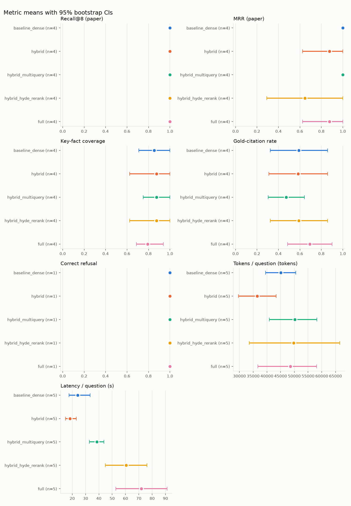
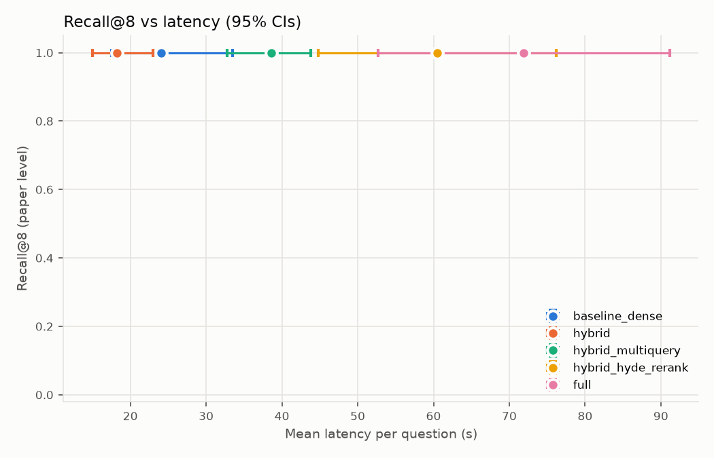

# Evaluation report - 20261122-133339

- **Split:** dev
- **Questions:** 5 (4 in scope, 1 out of scope); questions with results: 5
- **Strategies:** baseline_dense, hybrid, hybrid_multiquery, hybrid_hyde_rerank, full
- **Baseline:** baseline_dense
- **Models:** answer `anthropic/claude-sonnet-5.5`, judge `google/gemini-3.8-flash`, temperature 0.0
- **Git commit:** `fc98a7991d15 (dirty)`
- **Gold file:** `eval/gold_questions.yaml` (sha256 `d411e0ecc0ed`)
- **Bootstrap:** 10,000 resamples over questions, seed 0, 95% percentile CIs

> With about 40 test questions (and 20 dev questions), paired bootstrap CIs are wide: only large differences between strategies are detectable, and a CI that includes 0 means *no detectable difference*, not *no difference*. Differences on dev questions guide development only; the test split is for the final comparison.

## Metrics

| Metric | Group | Definition |
|---|---|---|
| Recall@8 (paper) | retrieval | a gold paper among the papers of the top-8 retrieved chunks |
| MRR (paper) | retrieval | 1 / rank of the first retrieved chunk from a gold paper |
| Key-fact coverage | answer | share of key facts the judge marked as covered |
| Gold-citation rate | answer | share of distinct cited papers that are gold papers |
| Supported-claim rate | answer | share of claims supported by the cited chunks (step 14 hook) |
| Correct refusal | abstention | out-of-scope questions answered with a correct refusal / correction |
| Tokens / question | cost | input + output tokens of the turn (judge excluded) |
| Latency / question | cost | wall-clock time of the turn |

Retrieval and answer metrics use in-scope questions only, correct refusal uses out-of-scope questions only, cost uses all. Retrieved chunks are those of all `search_knowledge_base` calls of the turn, in call order. `n` counts questions with a defined value (e.g. gold-citation rate needs at least one citation); differences use only questions defined for both strategies (`n` paired). The supported-claim rate is a hook for step 14 and is empty until a claim verifier is plugged in.

## baseline_dense

| Metric | n | Mean [95% CI] |
|---|---:|---|
| Recall@8 (paper) | 4 | 1.000 [1.000, 1.000] |
| MRR (paper) | 4 | 1.000 [1.000, 1.000] |
| Key-fact coverage | 4 | 0.854 [0.708, 1.000] |
| Gold-citation rate | 4 | 0.591 [0.325, 0.857] |
| Supported-claim rate | 0 | - |
| Correct refusal | 1 | 1.000 |
| Tokens / question (tokens) | 5 | 45,026 [39,549, 50,503] |
| Latency / question (s) | 5 | 24.1 [17.5, 33.5] |

## hybrid

| Metric | n | Mean [95% CI] | n paired | Δ vs baseline_dense [95% CI] |
|---|---:|---|---:|---|
| Recall@8 (paper) | 4 | 1.000 [1.000, 1.000] | 4 | +0.000 [+0.000, +0.000] |
| MRR (paper) | 4 | 0.875 [0.625, 1.000] | 4 | -0.125 [-0.375, +0.000] |
| Key-fact coverage | 4 | 0.875 [0.625, 1.000] | 4 | +0.021 [-0.188, +0.250] |
| Gold-citation rate | 4 | 0.584 [0.311, 0.857] | 4 | -0.007 [-0.048, +0.027] |
| Supported-claim rate | 0 | - | 0 | - |
| Correct refusal | 1 | 1.000 | 1 | +0.000 |
| Tokens / question (tokens) | 5 | 36,492 [29,642, 43,343] | 5 | -8,534 [-13,283, -3,678] |
| Latency / question (s) | 5 | 18.2 [15.0, 23.0] | 5 | -5.8 [-15.1, +0.3] |

## hybrid_multiquery

| Metric | n | Mean [95% CI] | n paired | Δ vs baseline_dense [95% CI] |
|---|---:|---|---:|---|
| Recall@8 (paper) | 4 | 1.000 [1.000, 1.000] | 4 | +0.000 [+0.000, +0.000] |
| MRR (paper) | 4 | 1.000 [1.000, 1.000] | 4 | +0.000 [+0.000, +0.000] |
| Key-fact coverage | 4 | 0.875 [0.750, 1.000] | 4 | +0.021 [-0.188, +0.250] |
| Gold-citation rate | 4 | 0.473 [0.303, 0.643] | 4 | -0.118 [-0.237, -0.000] |
| Supported-claim rate | 0 | - | 0 | - |
| Correct refusal | 1 | 1.000 | 1 | +0.000 |
| Tokens / question (tokens) | 5 | 50,164 [40,918, 58,176] | 5 | +5,138 [-679, +10,864] |
| Latency / question (s) | 5 | 38.6 [32.8, 43.8] | 5 | +14.5 [+5.0, +23.3] |

## hybrid_hyde_rerank

| Metric | n | Mean [95% CI] | n paired | Δ vs baseline_dense [95% CI] |
|---|---:|---|---:|---|
| Recall@8 (paper) | 4 | 1.000 [1.000, 1.000] | 4 | +0.000 [+0.000, +0.000] |
| MRR (paper) | 4 | 0.646 [0.292, 1.000] | 4 | -0.354 [-0.708, +0.000] |
| Key-fact coverage | 4 | 0.875 [0.625, 1.000] | 4 | +0.021 [-0.188, +0.250] |
| Gold-citation rate | 4 | 0.591 [0.324, 0.857] | 4 | -0.000 [-0.068, +0.067] |
| Supported-claim rate | 0 | - | 0 | - |
| Correct refusal | 1 | 1.000 | 1 | +0.000 |
| Tokens / question (tokens) | 5 | 49,739 [33,552, 66,598] | 5 | +4,713 [-9,426, +23,924] |
| Latency / question (s) | 5 | 60.5 [44.8, 76.2] | 5 | +36.4 [+21.7, +51.1] |

## full

| Metric | n | Mean [95% CI] | n paired | Δ vs baseline_dense [95% CI] |
|---|---:|---|---:|---|
| Recall@8 (paper) | 4 | 1.000 [1.000, 1.000] | 4 | +0.000 [+0.000, +0.000] |
| MRR (paper) | 4 | 0.875 [0.625, 1.000] | 4 | -0.125 [-0.375, +0.000] |
| Key-fact coverage | 4 | 0.792 [0.687, 0.938] | 4 | -0.062 [-0.188, +0.000] |
| Gold-citation rate | 4 | 0.693 [0.486, 0.900] | 4 | +0.102 [+0.029, +0.177] |
| Supported-claim rate | 0 | - | 0 | - |
| Correct refusal | 1 | 1.000 | 1 | +0.000 |
| Tokens / question (tokens) | 5 | 48,590 [36,712, 58,129] | 5 | +3,563 [-5,208, +13,979] |
| Latency / question (s) | 5 | 71.9 [52.7, 91.2] | 5 | +47.8 [+26.6, +72.5] |

## Figures

