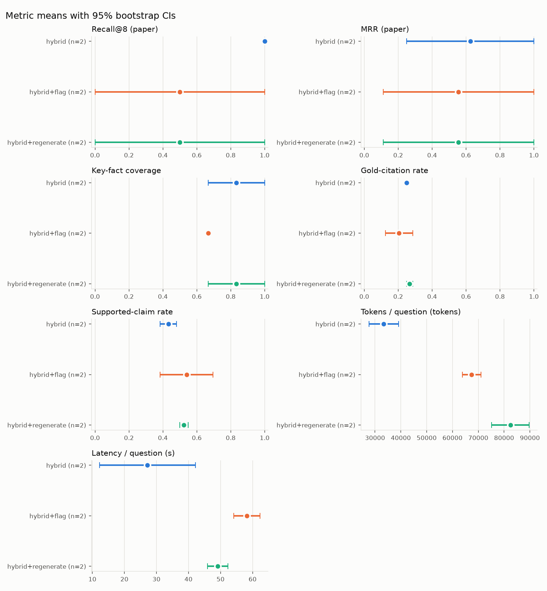
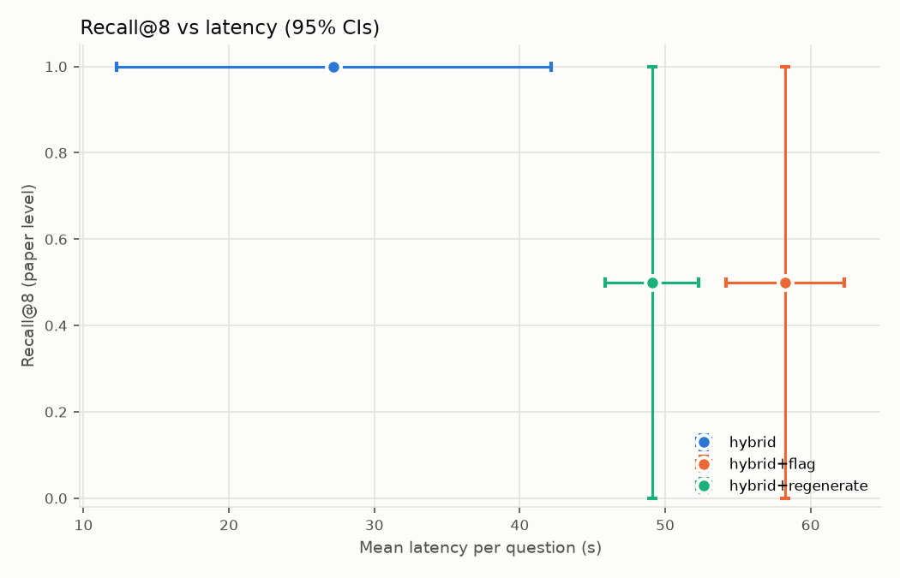

# Evaluation report - 20261123-073127

- **Split:** dev
- **Questions:** 2 (2 in scope, 0 out of scope); questions with results: 2
- **Strategies:** hybrid
- **Claim verification modes:** off, flag, regenerate (arms: hybrid, hybrid+flag, hybrid+regenerate)
- **Baseline:** not in this run (no paired differences)
- **Models:** answer `anthropic/claude-sonnet-5.5`, judge (key facts, refusals, claims) `google/gemini-3.8-flash`, temperature 0.0
- **Git commit:** `22a95ffbb3bd (dirty)`
- **Gold file:** `eval/gold_questions.yaml` (sha256 `d411e0ecc0ed`)
- **Bootstrap:** 10,000 resamples over questions, seed 0, 95% percentile CIs

> With about 40 test questions (and 20 dev questions), paired bootstrap CIs are wide: only large differences between strategies are detectable, and a CI that includes 0 means *no detectable difference*, not *no difference*. Differences on dev questions guide development only; the test split is for the final comparison.

## Metrics

| Metric | Group | Definition |
|---|---|---|
| Recall@8 (paper) | retrieval | a gold paper among the papers of the top-8 retrieved chunks |
| MRR (paper) | retrieval | 1 / rank of the first retrieved chunk from a gold paper |
| Key-fact coverage | answer | share of key facts the judge marked as covered |
| Gold-citation rate | answer | share of distinct cited papers that are gold papers |
| Supported-claim rate | answer | share of answer claims (cited + uncited factual sentences) the claim judge found supported by the cited chunks; partial counts as not supported |
| Correct refusal | abstention | out-of-scope questions answered with a correct refusal / correction |
| Tokens / question | cost | input + output tokens of the turn (judge excluded) |
| Latency / question | cost | wall-clock time of the turn |

Retrieval and answer metrics use in-scope questions only, correct refusal uses out-of-scope questions only, cost uses all. Retrieved chunks are those of all `search_knowledge_base` calls of the turn, in call order. `n` counts questions with a defined value (e.g. gold-citation rate needs at least one citation); differences use only questions defined for both strategies (`n` paired). The supported-claim rate needs at least one claim in the answer.

## hybrid

| Metric | n | Mean [95% CI] |
|---|---:|---|
| Recall@8 (paper) | 2 | 1.000 [1.000, 1.000] |
| MRR (paper) | 2 | 0.625 [0.250, 1.000] |
| Key-fact coverage | 2 | 0.833 [0.667, 1.000] |
| Gold-citation rate | 2 | 0.250 [0.250, 0.250] |
| Supported-claim rate | 2 | 0.433 [0.385, 0.481] |
| Correct refusal | 0 | - |
| Tokens / question (tokens) | 2 | 33,372 [27,606, 39,139] |
| Latency / question (s) | 2 | 27.2 [12.3, 42.1] |

## hybrid+flag

| Metric | n | Mean [95% CI] |
|---|---:|---|
| Recall@8 (paper) | 2 | 0.500 [0.000, 1.000] |
| MRR (paper) | 2 | 0.556 [0.111, 1.000] |
| Key-fact coverage | 2 | 0.667 [0.667, 0.667] |
| Gold-citation rate | 2 | 0.205 [0.125, 0.286] |
| Supported-claim rate | 2 | 0.540 [0.385, 0.696] |
| Correct refusal | 0 | - |
| Tokens / question (tokens) | 2 | 67,398 [63,806, 70,991] |
| Latency / question (s) | 2 | 58.2 [54.2, 62.3] |

## hybrid+regenerate

| Metric | n | Mean [95% CI] |
|---|---:|---|
| Recall@8 (paper) | 2 | 0.500 [0.000, 1.000] |
| MRR (paper) | 2 | 0.556 [0.111, 1.000] |
| Key-fact coverage | 2 | 0.833 [0.667, 1.000] |
| Gold-citation rate | 2 | 0.268 [0.250, 0.286] |
| Supported-claim rate | 2 | 0.524 [0.500, 0.548] |
| Correct refusal | 0 | - |
| Tokens / question (tokens) | 2 | 82,448 [75,146, 89,749] |
| Latency / question (s) | 2 | 49.1 [45.9, 52.3] |

## Verification effect

> Supported-claim rate = supported claims / (cited claims + uncited factual sentences); partially supported counts as not supported. Without verification (`off`) the answer is checked after the turn, outside the measured tokens and latency. `flag` only marks claims, so its answers equal `off` up to run-to-run variance; `regenerate` rewrites the answer once when a claim is unsupported and reports the rate of the final answer; `remove` reports the rate after unsupported sentences were cut. All rates come from the same judge model; see `eval/label_claims.py` for its agreement with hand labels.

| Strategy | Verification | Metric | n | Mean [95% CI] | n paired | Δ vs off [95% CI] |
|---|---|---|---:|---|---:|---|
| hybrid | off | Supported-claim rate | 2 | 0.433 [0.385, 0.481] | - | - |
| hybrid | off | Key-fact coverage | 2 | 0.833 [0.667, 1.000] | - | - |
| hybrid | off | Tokens / question (tokens) | 2 | 33,372 [27,606, 39,139] | - | - |
| hybrid | off | Latency / question (s) | 2 | 27.2 [12.3, 42.1] | - | - |
| hybrid | flag | Supported-claim rate | 2 | 0.540 [0.385, 0.696] | 2 | +0.107 [+0.000, +0.214] |
| hybrid | flag | Key-fact coverage | 2 | 0.667 [0.667, 0.667] | 2 | -0.167 [-0.333, +0.000] |
| hybrid | flag | Tokens / question (tokens) | 2 | 67,398 [63,806, 70,991] | 2 | +34,026 [+31,852, +36,200] |
| hybrid | flag | Latency / question (s) | 2 | 58.2 [54.2, 62.3] | 2 | +31.0 [+12.0, +50.1] |
| hybrid | regenerate | Supported-claim rate | 2 | 0.524 [0.500, 0.548] | 2 | +0.091 [+0.067, +0.115] |
| hybrid | regenerate | Key-fact coverage | 2 | 0.833 [0.667, 1.000] | 2 | +0.000 [+0.000, +0.000] |
| hybrid | regenerate | Tokens / question (tokens) | 2 | 82,448 [75,146, 89,749] | 2 | +49,075 [+36,007, +62,143] |
| hybrid | regenerate | Latency / question (s) | 2 | 49.1 [45.9, 52.3] | 2 | +21.9 [+3.8, +40.0] |

## Figures

